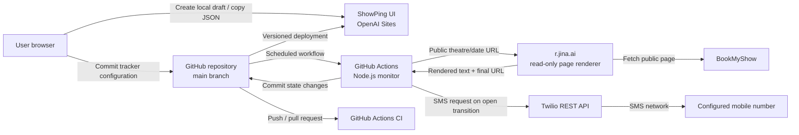

# ShowPing High-Level Design

| Attribute | Value |
| --- | --- |
| Status | Implemented and deployed |
| Last updated | 2026-11-08 |
| Source repository | `g-sanskar/bms-tracker` |
| Production UI | <https://showping-booking-tracker.pliantmap3.chatgpt.site> |
| Primary region/time zone | India / `Asia/Kolkata` |

## 1. Purpose

ShowPing is a personal BookMyShow availability tracker. It checks whether a specific movie, theatre, date, and optional presentation format has become bookable, then sends one SMS when that target transitions to open.

The design deliberately uses GitHub as both the control plane and the small persistent state store. This avoids a continuously running application server or database and fits a low-volume personal-use workload.

### Goals

- Check exact BookMyShow theatre/date pages on a five-minute schedule.
- Match the configured movie and format together, such as Ramayana in IMAX.
- Send at most one SMS for each closed/unknown to open transition.
- Avoid false alerts when BookMyShow blocks access, rate-limits, or redirects to another date.
- Keep credentials outside the repository.
- Support safe manual dry-runs and SMS delivery tests.

### Non-goals

- Reserving seats or completing a booking.
- Real-time or guaranteed five-minute delivery.
- A multi-user account system.
- Editing the production configuration directly from the hosted UI.
- Email delivery in the current release.

## 2. System context



The hosted UI and scheduled monitor are separate deployment paths. The UI helps create configuration, but GitHub is the production source of truth.

## 3. Component inventory

| Component | Location/runtime | Responsibility | Persistent data |
| --- | --- | --- | --- |
| Tracker UI | OpenAI Sites, server-backed Vinext/Cloudflare Worker | Creates browser-local tracker drafts and copies production-compatible JSON | Browser `localStorage` only |
| Source and configuration | GitHub repository, `main` branch | Canonical application source, tracker configuration, workflows, and notification state | Git history and repository files |
| Booking monitor | Node.js 22 in GitHub Actions | Validates trackers, fetches pages, evaluates availability, sends alerts, and updates state | None outside the checked-out repository |
| Scheduler | GitHub Actions cron | Starts the monitor every five minutes | Workflow run history |
| Page renderer | `r.jina.ai` | Retrieves a readable representation of the public BookMyShow page and exposes the final redirected URL | External transient cache, controlled by the provider |
| Booking source | `in.bookmyshow.com` | Authoritative public theatre/date listing | External system |
| SMS provider | Twilio REST API | Accepts and delivers SMS notifications | Twilio message records |
| State store | `data/state.json` | Records the last known state and notification metadata per tracker | Version-controlled JSON |
| CI verification | GitHub Actions | Runs monitor tests and the production UI build on pushes and pull requests | Workflow run history |

No D1 database or R2 object storage is configured; both bindings are explicitly `null` in `.openai/hosting.json`.

## 4. Deployed topology and hosted channels

### 4.1 Web channel

- **Host:** OpenAI Sites.
- **Production URL:** <https://showping-booking-tracker.pliantmap3.chatgpt.site>.
- **Application:** React/Next-compatible UI built with Vinext and deployed as a Cloudflare Worker bundle.
- **Access:** The Sites project currently uses custom access control.
- **Purpose:** Configuration assistance and local drafts. It does not run scheduled checks or store production trackers.

### 4.2 Source and control channel

- **Host:** GitHub.
- **Branch:** `main`.
- **Production configuration:** `data/trackers.json`.
- **Notification state:** `data/state.json`.
- **Secrets:** GitHub Actions repository secrets.
- **Change path:** A committed configuration change becomes active for the next scheduled workflow run.

### 4.3 Execution channels

| Workflow | Trigger | Purpose | Repository permission |
| --- | --- | --- | --- |
| `Verify project` | Push to `main` and pull requests | Installs dependencies, runs unit tests, and builds the UI | Read |
| `Check BookMyShow bookings` | Five-minute schedule or manual dispatch | Checks active trackers and sends transition alerts | Write, only to persist `data/state.json` |
| `Test SMS delivery` | Manual dispatch | Sends a labeled delivery test independent of booking state | Read |

The monitor workflow uses a concurrency group with cancellation disabled. This prevents overlapping monitor runs from racing to send the same alert or update the state file.

### 4.4 Data-acquisition channel

GitHub Actions requests `https://r.jina.ai/<bookmyshow-url>`. Only the public BookMyShow URL is sent to this renderer; Twilio credentials, the destination number, and repository secrets are never included.

Direct BookMyShow server requests are supported as an alternate mode, but the deployed workflow uses reader mode because BookMyShow commonly blocks plain server-side requests.

### 4.5 Notification channels

| Channel | Status | Notes |
| --- | --- | --- |
| SMS via Twilio | Deployed | The production alert channel. Twilio trial mode may substitute the configured predefined template for detailed event text. |
| Browser notification | Local UI test only | Demonstrates browser notification permission; it is not connected to scheduled booking checks. |
| Email | Not implemented | The UI marks email as coming later; no email provider or secrets are configured. |
| GitHub logs | Deployed operational channel | Each run records tracker state, reasons, errors, and summary counts without printing secret values. |

## 5. Production data model

Each item in `data/trackers.json` contains:

| Field | Required | Meaning |
| --- | --- | --- |
| `id` | Yes | Stable lowercase identifier used as the state key |
| `active` | No | Set to `false` to skip the tracker |
| `movie` | Yes | Primary title to match |
| `aliases` | No | Alternate non-empty BookMyShow title strings |
| `theatre` | Yes | Human-readable theatre name used in notifications |
| `city` | Yes | Human-readable city |
| `date` | Yes | Target date in `YYYY-MM-DD` |
| `format` | No | Presentation format such as `IMAX`; omitted means any format |
| `bookingUrl` | Yes | Exact HTTPS BookMyShow theatre/date `buytickets` URL |

`format: "IMAX"` is intentionally a broad substring match, so it accepts variants such as IMAX 2D, IMAX 3D, and IMAX Laser. Format matching is scoped to the matched movie section to prevent another movie's IMAX listing from opening the tracker.

The state file uses this logical structure:

```json
{
  "schemaVersion": 1,
  "trackers": {
    "tracker-id": {
      "lastKnownState": "open",
      "changedAt": "ISO-8601 timestamp",
      "notifiedAt": "ISO-8601 timestamp",
      "twilioMessageSid": "provider message identifier"
    }
  }
}
```

## 6. Runtime flows

### 6.1 Configuration flow

1. The user creates a local draft in the hosted UI or edits JSON directly.
2. The UI's **Copy GitHub JSON** action produces a tracker object.
3. The user adds or updates the object in `data/trackers.json` and pushes it to `main`.
4. CI validates the monitor tests and production UI build.
5. The next scheduled run reads the new configuration from GitHub.

The hosted UI cannot commit to GitHub and must not be treated as the production configuration database.

### 6.2 Scheduled monitoring flow

```mermaid
sequenceDiagram
    participant Cron as GitHub schedule
    participant Monitor as Node monitor
    participant Reader as r.jina.ai
    participant BMS as BookMyShow
    participant Twilio as Twilio
    participant Git as GitHub repository

    Cron->>Monitor: Start workflow
    Monitor->>Monitor: Load and validate trackers/state
    Monitor->>Reader: Request public theatre/date URL
    Reader->>BMS: Fetch listing
    BMS-->>Reader: Page or redirect
    Reader-->>Monitor: Rendered text and final URL
    Monitor->>Monitor: Evaluate date, movie, and format
    alt State is open and previous state was not open
        Monitor->>Twilio: Send SMS
        Twilio-->>Monitor: Message SID and status
        Monitor->>Git: Commit updated open/notified state
    else State changes to closed
        Monitor->>Git: Commit updated closed state
    else Unknown, dry-run, or unchanged
        Monitor->>Monitor: Log only; do not notify
    end
```

### 6.3 Availability decision

The evaluator returns one of three states:

- **Open:** The response remains on the requested date, the configured movie or alias is listed, and the required format appears within that movie's listing.
- **Closed:** The target date redirects to another date, the movie is absent, or the movie exists without the requested format.
- **Unknown:** The request is blocked, rate-limited, invalid, redirected away from BookMyShow, missing a recognizable date, or fails unexpectedly.

Unknown is fail-safe: it never sends an alert and never overwrites a known state.

### 6.4 Notification deduplication

An SMS is sent only when the current result is `open` and the stored state is not `open`. After Twilio accepts the request, the monitor writes the open state and message SID. Subsequent open checks do not send again.

If a later check returns `closed`, the stored state resets to closed. A future reopening can therefore produce a new alert. If Twilio rejects the request, the workflow fails without recording an open notification, allowing a later run to retry.

## 7. Security and trust boundaries

### 7.1 Secrets

The following values are stored as GitHub Actions secrets and are never committed:

- `TWILIO_ACCOUNT_SID`
- `TWILIO_AUTH_TOKEN`
- `SMS_TO_NUMBER`
- `TWILIO_MESSAGING_SERVICE_SID` or `TWILIO_FROM_NUMBER`
- `TWILIO_TRIAL_TEMPLATE` when required by a trial account

`.env.example` contains placeholder names only. Local `.env.local` files are ignored by Git.

### 7.2 Input and outbound controls

- Tracker URLs must use HTTPS, the exact `in.bookmyshow.com` hostname, and a `/buytickets/` path.
- The configured date must match the final `YYYYMMDD` path segment.
- Redirects away from BookMyShow produce `unknown`.
- Requests use a 15-second timeout.
- The renderer receives no credentials.
- Twilio credentials are sent only to the Twilio API over HTTPS using Basic authentication.
- GitHub's workflow token is read-only in CI and write-enabled only for the state-persisting monitor workflow.

### 7.3 Trust boundaries

BookMyShow content and rendered text are untrusted external input. They are normalized and searched but never executed. GitHub, OpenAI Sites, the renderer, and Twilio are separate external service boundaries with independent availability and retention policies.

## 8. Reliability and failure handling

| Condition | System behavior |
| --- | --- |
| BookMyShow redirects to another date | `closed`; no alert |
| HTTP 403 or 429 | `unknown`; no state change or alert |
| Bot-check/access-block marker | `unknown`; no state change or alert |
| Renderer or network failure | Workflow records a failure and exits non-zero |
| Invalid tracker configuration | Error annotation; that tracker is not checked |
| Twilio rejects an SMS | Workflow fails; notification is not marked sent and can retry |
| Show date has passed | Tracker is skipped |
| Concurrent scheduled run | Serialized by the workflow concurrency group |
| No state change | No repository commit is created |

GitHub's schedule is best-effort. A five-minute cron interval does not guarantee exact execution time, especially during GitHub Actions congestion.

## 9. Observability and operations

GitHub Actions is the operational console. Each monitor run logs:

- Tracker identifier.
- Evaluated state and human-readable reason.
- Twilio acceptance status and message SID when an alert is sent.
- Total trackers checked, whether state changed, and failure count.

Recommended operational actions:

- Use a manual **Check BookMyShow bookings** run with `dry_run: true` after changing a tracker.
- Use **Test SMS delivery** to validate Twilio independently.
- Inspect failed workflow annotations before changing state manually.
- Pause a tracker with `"active": false` rather than deleting its state during diagnosis.
- Rotate any credential immediately if it is exposed outside the secrets store.

## 10. Deployment and recovery

### Monitor deployment

Pushing to `main` deploys tracker and monitor changes logically: scheduled GitHub Actions always check out the latest branch state. CI must pass before a change is considered verified.

### UI deployment

The UI is built with `npm run build`, saved as a version of the existing OpenAI Sites project, and deployed to the production Sites URL. The Sites project ID is retained in `.openai/hosting.json`.

### Recovery

- The GitHub repository is the canonical recovery source for code, configuration, workflows, and state.
- GitHub Actions secrets must be recreated separately because they are intentionally absent from Git history.
- OpenAI Sites can be rebuilt and redeployed from a known good Git commit.
- Deleting or resetting `data/state.json` does not lose configuration, but it may cause one repeat SMS if the booking is already open.
- Twilio message history provides an external audit of accepted SMS requests.

## 11. Constraints and future improvements

Current constraints:

- Page parsing depends on BookMyShow and renderer output structure.
- The renderer is an additional third-party availability dependency.
- Git-based state is appropriate for personal scale, not high-volume or multi-user workloads.
- The UI is a draft generator rather than a production administration console.
- Twilio trial accounts can restrict recipients and message content.

Potential future improvements:

- Add email through a dedicated provider and transition-specific delivery records.
- Add a secured API for UI-to-GitHub configuration updates.
- Replace Git state with transactional storage if tracker volume or concurrency grows.
- Add provider health metrics and alerting for repeated `unknown` results.
- Add schema versioning and automated configuration validation on pull requests.

